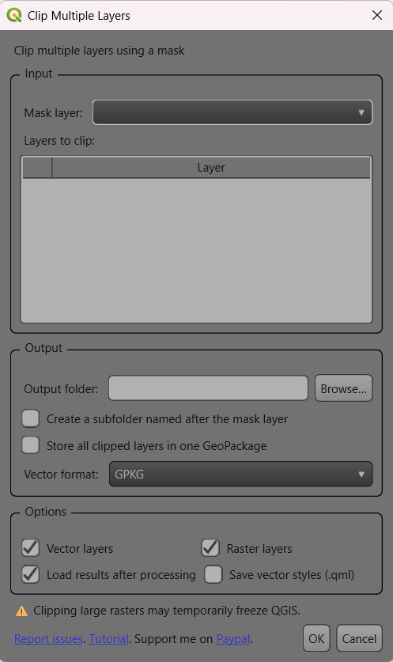

[](https://plugins.qgis.org/plugins/ClipMultipleLayers/)
[](https://www.paypal.com/cgi-bin/webscr?cmd=_s-xclick&hosted_button_id=4DC3A78C398HW)

# Plugin for QGIS: Clip Multiple Layers

## Description
<p align="center">

</p>
This plugin allows you to clip multiple vector and raster layers using a selected mask layer. The resulting layers can then be loaded into the project.
Optionally, create an output subfolder named after the selected mask layer.
You can also store all clipped vector and raster layers in one
`clipped_layers.gpkg` file, each as a separate GeoPackage table.

---

## Issues
You can report a new issue [here](https://github.com/Taknok/Qgisplugin-ClipMultipleLayers/issues/new) and view existing ones [here](https://github.com/Taknok/Qgisplugin-ClipMultipleLayers/issues).


## Translators
Duplicate a `.ts` file for the new language and create a new PR.

## Developers

### 0. Development setup

The plugin sources are in `ClipMultipleLayers/`; this directory is also the
root of the plugin package published to QGIS.

```bash
python -m virtualenv venv
source venv/bin/activate
pip install -r requirements.txt
sudo apt install qt6-tools-dev-tools   # Linux
```

### Development container

Open the repository from a WSL distribution with WSLg enabled, then choose
**Dev Containers: Reopen in Container** in VS Code. The container installs
QGIS, Python dependencies from `requirements.txt`, and Qt 6 tools. WSLg is used
to display the QGIS desktop application. Start QGIS from the container
terminal using `bash scripts/run-qgis.sh`. This launcher isolates QGIS from
the project's Python virtual environment, whose Qt bindings can conflict with
the system Qt used by QGIS.

Run these commands from the repository root inside the container:

```bash
# 1. Extract UI strings into every translation file
bash scripts/update-strings.sh

# 2. Compile all translations
bash scripts/compile-translation.sh
```

### 1. Load the plugin dynamically in QGIS
Windows:
```cmd
cmd /c mklink /d %APPDATA%\QGIS\QGIS4\profiles\default\python\plugins\ClipMultipleLayers D:\path\to\Qgisplugin-ClipMultipleLayers\ClipMultipleLayers
```

Linux:
```bash
ln -s /path/to/Qgisplugin-ClipMultipleLayers/ClipMultipleLayers ~/.local/share/QGIS/QGIS4/profiles/default/python/plugins/ClipMultipleLayers
```

### 2. Extract translatable strings from UI files
```bash
bash scripts/update-strings.sh
```

### 3. Compile translations
```bash
bash scripts/compile-translation.sh
```

### 4. UI editing
Edit the UI file using Qt Designer (Qt Creator): `ClipMultipleLayers/src/ui/clip_multiple_layers_dialog_base.ui`

When using `pb_tool`, run it from the `ClipMultipleLayers/` directory so its
paths resolve relative to the plugin sources.

The plugin icon is loaded directly from `icon.png`; no Qt resource compilation
is needed.

### 5. Automated releases

Pushes to `master` run semantic-release. Commit messages follow Conventional
Commits: `fix:` creates a patch release, `feat:` a minor release, and a
breaking change creates a major release. The first workflow run creates the
`v4.0.0` baseline tag if it is missing; that run does not publish a release.
Subsequent releases are attached to a GitHub Release and uploaded to the QGIS
plugin repository.

Before the first release, add an Actions repository secret named
`QGIS_PLUGIN_TOKEN` using a token generated from the QGIS plugin page.

To retry publishing an existing release, run the **Release** workflow manually
from `master` and enter the version without the `v` prefix. The semantic-release
job is skipped, and the plugin is packaged from the matching `vX.Y.Z` tag. An
existing ZIP asset on that GitHub release is not uploaded a second time.

## Donation
If you find this plugin useful, feel free [to support me](https://www.paypal.com/cgi-bin/webscr?cmd=_s-xclick&hosted_button_id=4DC3A78C398HW)

## Acknowledgements
Thank to :
 - [shtirlitsDva](https://github.com/shtirlitsDva)
 - [zsiki](https://github.com/zsiki)
